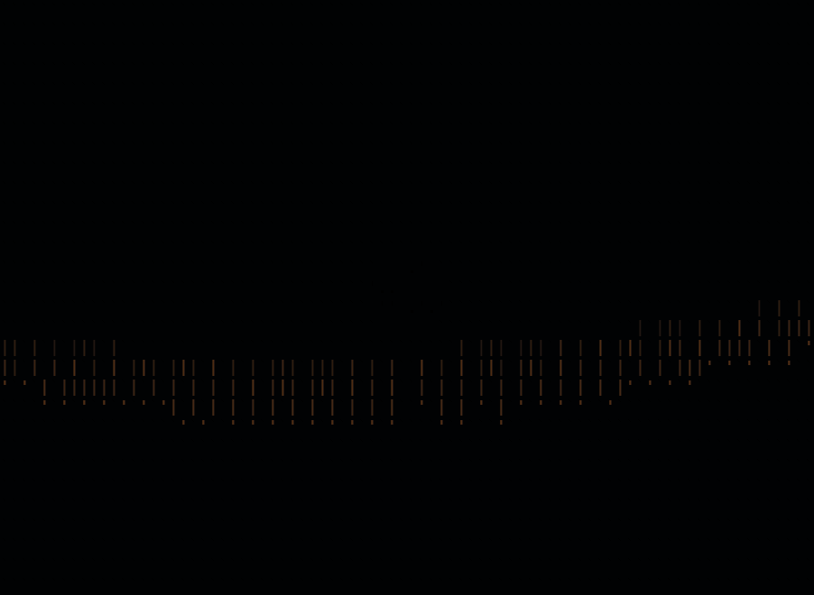

# Eye → Space

A detailed eye rendered as **animated ASCII art** in Python. The eye opens, looks around, blinks, and then the camera slowly pulls back: the pupil becomes a window into space, a heart-shaped nebula forms in the background, and the scene fills with stars, shooting stars and a comet.

No terminal required: the animation is drawn on a **Tkinter** canvas with a monospaced font, and every frame is computed in real time with **NumPy**.

## Preview



*A 12-second excerpt rendered at 8 fps: the eye opens, blinks, and the camera pulls back as the star field emerges and the nebula begins to form.*

## Features

- **Live ASCII rendering** — each frame is computed as an image and mapped to a 70-character luminance ramp.
- **Fully procedural scene** — iris with radial fibers, crypts, limbal ring, pupil with highlights, veined sclera, eyelids, lashes and skin. No external image assets.
- **Cinematic zoom** — a smooth transition from a close-up of the eye to a parallax star field.
- **Star field with depth** — 3,200 particles that twinkle and drift; the brightest ones are drawn with cross-shaped sparkles.
- **Heart nebula** — slowly forms in the background, visible through the pupil, using an implicit heart equation and noise textures.
- **Shooting stars and comet** — appear at random intervals once the scene reaches space.
- **Real-time optimizations** — only cells that changed are redrawn, and the drawing budget recalibrates automatically to hold ~30 FPS.
- **Deterministic** — random seeds are fixed, so the animation is reproducible.

## Requirements

- **Python 3.8+**
- **NumPy** (the only external dependency)
- **Tkinter** (bundled with Python on macOS and Windows)

On Linux, Tkinter usually ships in a separate package:

```bash
sudo apt install python3-tk        # Debian / Ubuntu
sudo dnf install python3-tkinter   # Fedora
```

## Installation

```bash
git clone <repository-url>
cd Eyes

python3 -m venv .venv
source .venv/bin/activate          # Windows: .venv\Scripts\activate

pip install numpy
```

## Usage

```bash
python3 eyes.py
```

The window centers itself on screen and adapts to the available height (up to 30 rows of text).

## Controls

| Key | Action |
| --- | --- |
| `Esc` | Close the window |
| `R` | Restart the animation from the beginning |

## Animation timeline

| Time | What happens |
| --- | --- |
| `0.0 s` | Fade-in and eye opening |
| `4.0 s` | Blink |
| `5.4 s` | Zoom-out begins (lasts 28 s) |
| `6.9 s` | Stars appear |
| `8.9 s` | The heart nebula starts to form |
| `~30 s` | First shooting stars |
| `33.4 s` | Zoom ends; the eye has fully dissolved into space |
| `34.9 s` | The comet appears |

After that, the scene continues in space indefinitely.

## How it works

The per-frame pipeline inside `render_cells()`:

1. **Procedural scene** — the eye geometry is evaluated in normalized coordinates with distance functions and smoothstep (`ss`), using 2× supersampling to avoid aliasing.
2. **Noise textures** — multi-octave value noise (`tex2d`, `noise1d`) generates the iris fibers, skin, veins and space grain.
3. **Star field** — particles with depth (`SD`) are projected, twinkled and recycled when they leave the camera; shooting stars are drawn as character strokes (`-`, `|`, `/`, `\`).
4. **Nebula** — an implicit heart equation `(x² + y² − 1)³ − x²y³ = 0`, warped with noise and mixed with a halo, rim and pulsing glow.
5. **Post-processing** — bloom (blur of bright areas), tone mapping `1 − e^(−2x)` and vignette.
6. **ASCII rasterization** — each 2×2 pixel block is averaged, converted to luminance and indexed into `RAMP`; color is quantized to 24 levels per channel (`QL`).
7. **Incremental drawing** — character indices and colors are compared with the previous frame (`plan_updates`), and only changed cells are updated.

### Adaptive budget

Tkinter is the bottleneck, not the render. Every frame measures the cost of updating a cell and adjusts how many cells it can touch to stay within `TK_MS` (13 ms). When the scene changes a lot, it prioritizes the cells with the largest visual difference.

## Customization

Almost every setting lives at the top of `eyes.py`:

| Constant | Value | Effect |
| --- | --- | --- |
| `SIZE` | `8` | Font size |
| `FPS` | `30` | Target frames per second |
| `SS` | `2` | Internal supersampling factor |
| `ASPECT` | `1.40` | Grid width-to-height ratio |
| `MAXROWS` | `30` | Maximum character rows |
| `TK_MS` | `13.0` | Drawing budget per frame (ms) |
| `T_Z0` / `T_ZD` / `ZEND` | `5.4 / 28 / 14` | Zoom start, duration and final factor |
| `T_HEART` / `T_HEART_D` | `8.9 / 26` | Nebula start and duration |
| `WO` | `0.78` | Eye width |
| `RI` / `RP0` | `0.27 / 0.098` | Iris and pupil radii |
| `GS0` | `0.085` | Initial star spread |
| `RAMP` | — | Luminance ramp (70 characters, dark to bright) |

For a lighter effect, lower `FPS`, `SS` or `MAXROWS`; for more detail, raise them (at the cost of CPU).

## Project structure

```
Eyes/
├── eyes.py            # the whole project: scene, render, stars and Tkinter loop
├── assets/
│   └── preview.gif    # animated preview used in this README
└── README.md
```

Main blocks in `eyes.py`:

| Function / block | Responsibility |
| --- | --- |
| `init()` | Builds the grid, coordinates and buffers from the screen size |
| `eye_scene()` | Renders the eye: iris, pupil, sclera, skin and eyelids |
| `heart_nebula()` | Generates the heart-shaped nebula |
| `stamp_stars()` / `stamp_streak()` | Draws stars, sparkles and shooting stars onto the grid |
| `stamp_lashes()` | Draws lashes as character strokes |
| `bloom()` | Brightness post-processing |
| `render_cells()` | Orchestrates everything and returns characters + colors |
| `plan_updates()` | Decides which cells need updating |
| `main()` | Creates the window, canvas and animation loop |

## Performance

The script is CPU-intensive because it renders full images several times per second. If you notice stutter or the fan spins up:

- Lower `FPS` to `24` or `20`.
- Lower `SS` from `2` to `1` (less antialiasing).
- Lower `MAXROWS`.
- Close other GPU/CPU-heavy applications.

## Troubleshooting

| Problem | Solution |
| --- | --- |
| `ModuleNotFoundError: No module named 'tkinter'` | Install your distribution's `python3-tk` package |
| `ModuleNotFoundError: No module named 'numpy'` | `pip install numpy` |
| The window does not appear | It may be behind the terminal; use `Cmd+Tab` (macOS) or `Alt+Tab` |
| It runs slowly | Lower `FPS`, `SS` or `MAXROWS` |
| I want to reach space sooner | Lower `T_Z0` and `T_ZD` (and `T_HEART` to bring the nebula forward) |

## License

This project does not include an explicit license. If you plan to publish it, add a `LICENSE` file with the license of your choice (for example, MIT).
